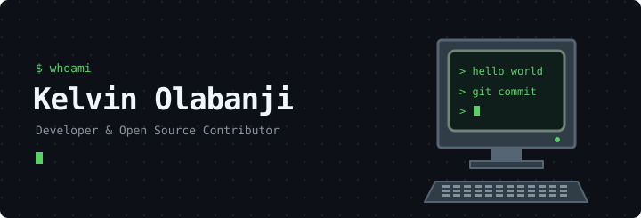

## About Me

I'm a Computing undergraduate at the University of Namibia, interested in software engineering, artificial intelligence and open-source development.

- Currently contributing to **MusicBrainz Picard**.
- Building desktop applications and AI-powered tools.
- Interested in machine learning and software engineering.
- Based in Namibia.

## Tech Stack

**Languages**

**Frameworks & Libraries**

**AI & Data**

**Developer Tools**

## Featured Projects

<table>
<tr>
<td width="50%" valign="top">

### [Echo](https://github.com/kelvinolabanji/echo)

Privacy-first semantic image search for Windows. Find images using natural language without uploading your files to the cloud.

`Python` `C#` `.NET 8` `CLIP` `FAISS` `FastAPI`

</td>
<td width="50%" valign="top">

### [SponsorSkip](https://github.com/kelvinolabanji/sponsorskip)

An AI-powered browser extension that identifies and skips sponsored segments in YouTube videos using video transcripts.

`JavaScript` `Python` `FastAPI` `Groq` `PostgreSQL`

</td>
</tr>
</table>

## Open Source Contributions

### [MetaBrainz — MusicBrainz Picard](https://github.com/metabrainz/picard)

Contributing to an open-source, cross-platform music metadata tagging application.

| Pull Request | Contribution | Status |
| :--- | :--- | :--- |
| [#3571](https://github.com/metabrainz/picard/pull/3571) | iTunes podcast metadata support for ID3 and MP4 files. |  |
| [#3606](https://github.com/metabrainz/picard/pull/3606) | Consistent whitespace handling in tagging script output. |  |

## GitHub Statistics

## Contribution Activity

---

<code>git commit -m "keep building"</code>

